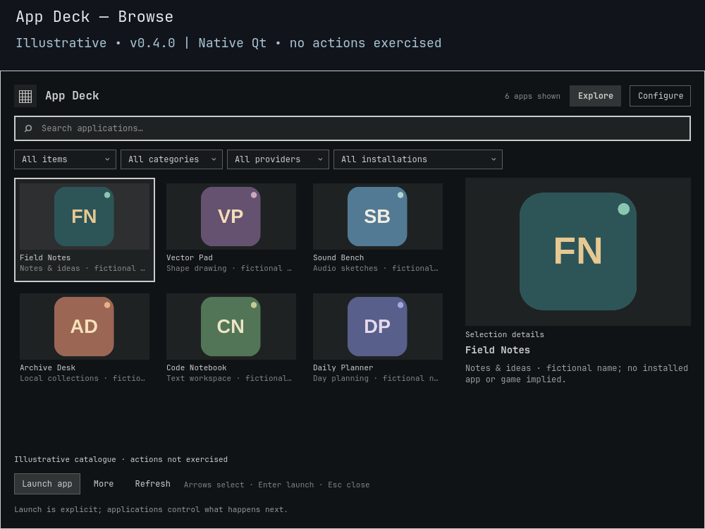
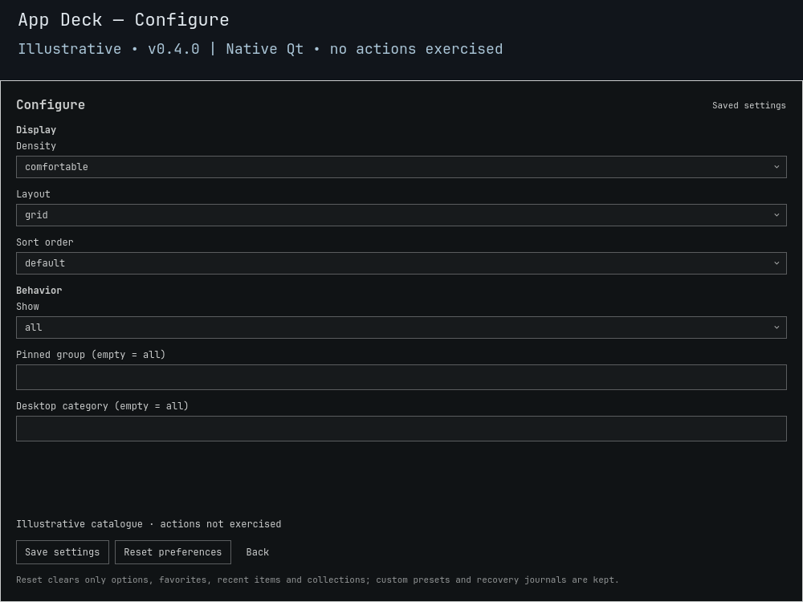

# App Deck

**Your installed apps, arranged around what you do.**

Find a local application, keep a Writing or Daily tools group close, and launch a declared action such as New Window when the app provides one. App Deck reads your **installed XDG desktop entries**, rather than inventing another application catalogue.

[](https://github.com/Battlelamb/omarchy-app-deck/actions/workflows/ci.yml)
[](LICENSE)

[Install](#install-and-open) · [Controls](#controls) · [Preferences](#make-it-yours) · [Limits](#limits-and-safety) · [Backend reference](BACKEND.md)

> **v0.4.0 · development candidate, not a stable release.** Offline backend checks cover desktop-ID copying and saved display schemas. Earlier open/close checks do not qualify this candidate; native UI integration, live clipboard/app actions and full-shell upgrade/rollback remain separate gates. Helper acceptance is not application startup. The install command follows the published branch, which may still be an earlier version.



*Illustrative **0.4.0** native Qt component render with fictional/original example data. No installed library, desktop action or full-shell behavior is demonstrated. [Preview provenance](docs/PREVIEW.md).*

<details>
<summary>Preview native saved settings</summary>



*Illustrative Configure view; fields may scroll. The capture does not exercise Save or Reset.*

</details>

## A deck for the task at hand

| When you want to… | Use… |
| :--- | :--- |
| Find an installed app | Search its name and desktop-entry details in a selectable grid |
| Keep daily tools nearby | Favorites and named personal groups |
| Build a focused Writing view | A personal group, optionally combined with an `Office` category filter |
| Open an app-specific action | A separate **App · Action** row, if declared by the installed desktop entry |
| Identify an installed launcher precisely | **More → copy app id** (`copy-app-id`), such as `org.example.Editor.desktop` |
| Return to a recent choice | Recent IDs saved after accepted launch or ID-copy requests |
| Recognize an app visually | Supported local PNG/JPEG icons, with a fallback when unavailable |

Application rows honor XDG precedence and desktop visibility checks. Apps and their declared actions come from your machine; no apps, desktop entries or icon library are bundled or downloaded.

## Install and open

Requires **Omarchy Quattro** with compatible Quickshell/Qt, `qs.Ui` and `qs.Commons`, system Python 3, GNU `timeout` and `gio`; ID copying additionally needs `wl-copy` from `wl-clipboard`. No companion plugin, hub or indexing daemon is required.

Review the source before enabling this testing snapshot:

```sh
omarchy plugin add https://github.com/Battlelamb/omarchy-app-deck.git --enable
omarchy-shell shell summon leviathan.app-deck
```

<details>
<summary><strong>Optional: Super+Space → Trigger → App Deck</strong></summary>

Installation does **not** add a menu entry or hotkey. Back up `~/.config/omarchy/extensions/omarchy-menu.jsonc`, then merge this entry into its existing top-level object. Preserve other entries and add the necessary comma between siblings. For a new file, use the complete object:

```jsonc
{
  "trigger.app-deck": {
    "label": "App Deck",
    "action": "omarchy-shell shell summon leviathan.app-deck"
  }
}
```

The `trigger.` prefix places it under the native **Trigger** category. Do not replace the stock menu or your existing extension file.

</details>

## Controls

| Input or control | Result |
| :--- | :--- |
| Type while the catalogue has focus | Search the current app/action catalogue |
| Arrow keys / Home / End | Navigate the current grid or list / first match / last match |
| Click a tile | Select only, without launching |
| Enter / primary Launch button | Request launch of the selected app or declared action |
| More | Copy the desktop-entry ID, toggle Favorite or manage a personal group |
| View selector | Open All items, Favorites, Recent or a personal group |
| Configure | Save the default view, pinned group and desktop category |
| Refresh | Reread installed desktop entries |
| Esc / outside click | Dismiss; Esc from Configure returns to the catalogue |

## Make it yours

To build a group, select an app or action, open **More**, enter a **Collection name** such as Writing, then choose **Add/remove item**. The view selector opens that group later. Pinned groups and personal collections are the same saved feature, not a separate workspace launcher. **Delete collection** removes the group, not the applications.

In **Configure**, choose a saved view and pinned group, then optionally enter a desktop-category token such as `Office`, `Utility` or `Development`. Empty means all categories. The filter matches any declared category, even if the row displays a different first category. Select **Save settings** to keep your choices; saved filters intersect.

A cover-like app deck and a text-first launcher use the same saved schema: `density` = **comfortable** / compact, `layout` = **grid** / list, `sortOrder` = **default** / name / favorites-first. Bold values are defaults. Display choices never turn a saved ID into permission to launch.

**Copy app ID** copies the installed desktop-entry identifier, not its filesystem path or Exec line. On an **App · Action** row it copies the parent `.desktop` ID without the `::Action` suffix, after validating that exact action still exists. Copying does not launch GIO or execute the desktop entry; it replaces the clipboard only on an explicit request. No clipboard contents or history are read.

Preferences survive source updates at:

```text
$XDG_CONFIG_HOME/omarchy/lego/app-deck/preferences.json
```

If `XDG_CONFIG_HOME` is unset or relative, the fallback is `~/.config/omarchy/lego/app-deck/preferences.json`. **Configure → Reset preferences** clears only this plugin's options, favorites, recent IDs and groups. It does not edit desktop files or application settings. Recent tracks helper-accepted launch and ID-copy requests, not whether an app actually opened or still owns the clipboard.

## Limits and safety

- **Installed desktop entries retain normal launcher trust.** GIO can execute their installed Exec/DBus behavior. This plugin does not sandbox apps or accept an arbitrary input command/path to launch.
- Launch and ID-copy actions are checked against fresh local membership. Only actions declared by a visible installed entry are admitted; a saved ID cannot resurrect a removed action.
- Declared actions launch through a private temporary desktop snapshot. `%k` refers to that snapshot, not the original file. Actions depending on the original desktop identity or extra vendor fields may not work.
- Launch acceptance is not startup confirmation. A timeout may follow partial acceptance; dismissing cannot undo a launch. There is no Restore.
- Scans admit at most **4,096 app/action rows**; display is limited to **1,024 rows** and a byte budget. Names are unlocalized. Local PNG/JPEG lookup is not a complete icon-theme implementation; SVG and remote icons are unsupported.
- New preference saves have a **128 KiB aggregate budget**. Rejected saves preserve the file. A later Recent-save or optional-snapshot warning does not reverse a confirmed launch or copy request.

<details>
<summary><strong>Verification and troubleshooting</strong></summary>

Offline tests cover desktop parsing, visibility, action revalidation and saved preferences in a fake HOME. An actual installed GIO launches a harmless file-writing fixture inside the offline box, without windows; other cases use controlled helpers. This is not proof that every real app or declared action works. See [validation notes](docs/VALIDATION.md) and [CI scope](docs/CI.md); the badge links to the actual hosted workflow status.

From a checkout, with `TMPDIR` set to an existing private scratch directory:

```sh
env -u PYTHONPATH PATH=/usr/bin /usr/bin/python3 scripts/run-tests.py --backend-only
env -u PYTHONPATH PATH=/usr/bin bash test.sh
```

The backend runner needs `bwrap`; the full suite also needs Node.js and the native Qt/Quickshell test dependencies. Offscreen UI fixtures, historical previews and earlier-version checks do not qualify v0.4.0 native display controls, live clipboard/app actions, full-shell upgrade/rollback, long-soak or all-scale behavior.

| Symptom | Check |
| :--- | :--- |
| An app is missing | Clear the query and filters, then Refresh; hidden, malformed or desktop-incompatible entries can be excluded |
| A category looks inconsistent | Configure matches every declared category, not only the first one shown in a row |
| A desktop action is absent | Its installed entry must list the action and provide a valid matching action section |
| An app/action request fails | Check GIO and that application's installed launcher separately; helper success is not startup proof |
| Icons look incomplete | Only bounded local raster lookup is supported; theme inheritance and SVG lookup are not complete |

See [BACKEND.md](BACKEND.md) for exact XDG roots, CLI syntax, snapshot behavior and bounds. Never include private desktop files or application paths in public reports without reviewing them.

</details>

<details>
<summary><strong>Disable or remove</strong></summary>

```sh
omarchy plugin disable leviathan.app-deck
omarchy plugin remove leviathan.app-deck
```

Remove your optional menu entry separately. Use Reset first if you want this plugin's saved preferences cleared; application settings are not part of that reset.

</details>

---

Independent community plugin, not an official Omarchy or HyDE release. Original code: **GPL-3.0-only**. No application binaries, desktop files or third-party icons are bundled. [License](LICENSE) · [Source notices](NOTICE.md) · [Backend lineage](NOTICE.backend.md) · [Contributing](CONTRIBUTING.md) · [Security](SECURITY.md)
