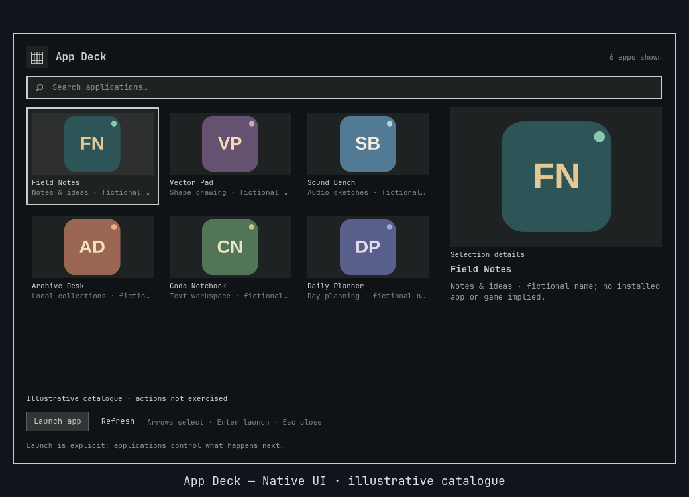

# App Deck



Search validated local XDG desktop entries, inspect their icons and launch explicitly. Not an arbitrary command runner; desktop application behavior remains external.

**Small independent Omarchy Quattro plugin.** No other Lego plugin is required. Native theme colors, keyboard-first selection, bounded local catalogues and explicit actions; no new service or mandatory hotkey.

## Install and open

Unpublished v0.2.0 candidate. The repository below is a **proposed publication target**, not a claim that it exists. After publication:

```sh
omarchy plugin add https://github.com/Battlelamb/omarchy-app-deck --enable
omarchy-shell shell summon leviathan.app-deck
```

Before publication, install from a reviewed **Git checkout** with `omarchy plugin add "$PWD" --enable`. The release tarball is a current-commit source export, not an automatic installer. Never extract over an existing installation.

Type to search; arrows select; Enter invokes the named primary action. A tile click only selects. Escape/outside dismisses. Refresh rereads. Restore follows its owned receipt even when search has no results. Restore/Keep appear only when advertised by the backend. Dismissing cannot undo work already accepted by external applications/providers.

### Optional Super+Space entry

Back up `~/.config/omarchy/extensions/omarchy-menu.jsonc`, then **merge this entry without replacing existing entries**. No dedicated shortcut is needed:

```json
{
  "trigger.app-deck": {"label": "App Deck", "action": "omarchy-shell shell summon leviathan.app-deck"}
}
```

It appears under **Trigger** in the existing Omarchy menu. Static entries should be removed when their plugin is uninstalled.

## Requirements and safety

Requires the Omarchy Quattro shell, its native `qs.Ui`/`qs.Commons`, compatible Quickshell/Qt, system Python3 and the tools listed in [BACKEND.md](BACKEND.md). Legacy shell releases are not claimed compatible. Runtime code runs **unsandboxed** inside the existing shell. Native providers/hooks can have their documented normal side effects; no blanket rollback or security-audit claim.

The UI uses native theme tokens, plain-text untrusted labels, English fallback translations and virtualization. Closed overlays stop catalogue/lock polling. Retained native component ownership and independent effect recovery keep their documented limits. No bundled wallpapers, game art, fonts, cloud endpoints or shared runtime framework.

## Verify and remove

```sh
export TMPDIR="${TMPDIR:-$HOME/.cache/omarchy-plugin-tests}"
mkdir -p -m 700 "$TMPDIR"
env -u PYTHONPATH PATH=/usr/bin bash test.sh
omarchy-shell shell hide leviathan.app-deck
omarchy plugin disable leviathan.app-deck
# Only when removal is wanted:
omarchy plugin remove leviathan.app-deck
```

Tests run offline in a fake HOME with fixture providers; they are not proof that every external app, GPU or hook works. Use **Restore before disabling/removing an applied effect**. Do not remove a checkout with unsaved changes. Details: [validation](docs/VALIDATION.md), [backend contract](BACKEND.md), [release gates](docs/RELEASING.md).

GPL-3.0-only. Full license and exact source/dataset rights: LICENSE, NOTICE.md, NOTICE.backend.md. Community plugin, not an official Omarchy or HyDE release.

Visual hierarchy reference: [Mosaic](https://github.com/naolselemon/mosaic), inspected at `9b3f4d78611b5714f2039be48e59922c1158301a`. Design principles only; no Mosaic code, branding or assets are bundled.
